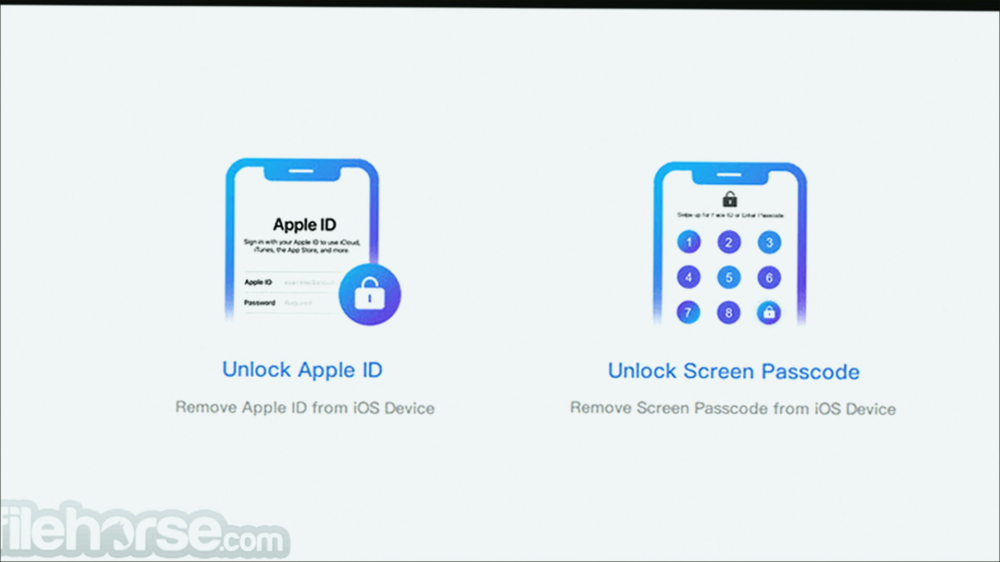
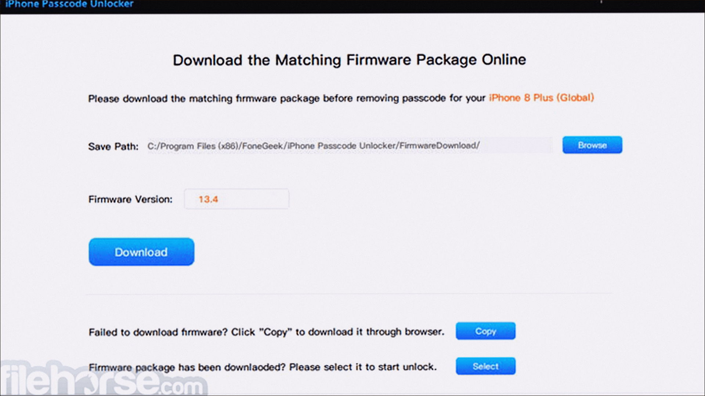
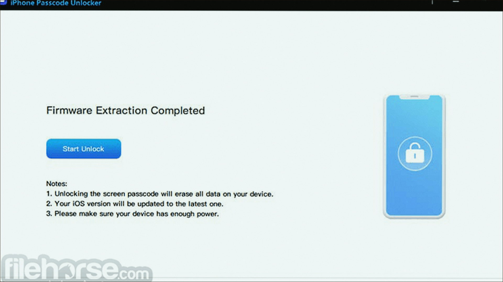

# Windows notes: Unlocker

**Emptyloop** · 1.9.2 · 190 KB · Utilities catalog

[Open card](https://moggydayprogram.com/programs/unlocker) · [English](https://moggydayprogram.com/en/programs/unlocker) · [GitHub Pages](https://meshherbalistknow.github.io/unlocker-windows/?lang=en)

  
  
  

Удаляет «файл занят другой программой». Классика, бесплатно.

Unlocker on Windows 10/11 x64. 190 KB. Requirements, screenshots, MoggyDay Launcher.

Get it from the catalog card, not from this repository.

| Field | Value |
| --- | --- |
| Build | 1.9.2 x64 |
| OS | Windows 10/11 x64 |
| Pages | https://meshherbalistknow.github.io/unlocker-windows/ |

- [7-Zip](https://moggydayprogram.com/programs/7-zip)
- [Total Commander](https://moggydayprogram.com/programs/total-commander)
